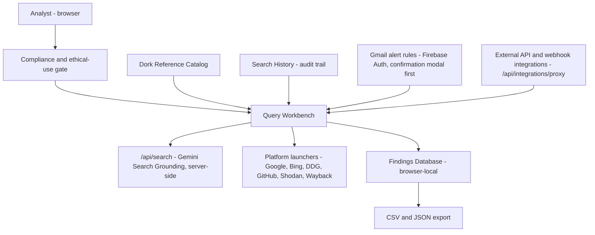
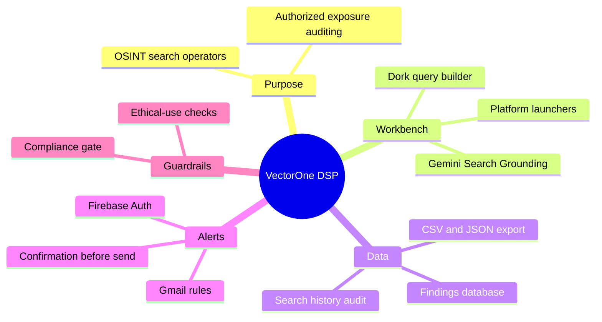

# VectorOne_DSP

**An automated multi-platform search operator workbench for authorized OSINT and exposure auditing — built by Catalyst Vector AIA.**

VectorOne_DSP lets security analysts, compliance teams, and researchers build, validate, and run structured search operator queries ("Google dorks") across multiple platforms, filter results by target domain and sensitive-data categories, store what they find in a searchable local database, and export structured reports — all inside one deterministic, transparent workspace with an explicit ethical-use gate up front.

> **Authorized use only.** VectorOne_DSP is designed for auditing public exposure on domains you own or are authorized to assess. The app opens with an Ethical Use, Privacy Law Compliance, and Catalyst Vector AIA Liability Disclaimer acknowledgment before any query can run, and that compliance view stays accessible from the sidebar and footer.

## What it does

- **Query Workbench** — compose queries from keyword presets, target-domain constraints (`site:`, subdomain exclusions, path prefixes, date bounds), and Sensitive Data Query Filters (PII indicators, exposed config/env files, credentials/tokens, financial and regulated documents)
- **Live search execution** — server-side Gemini Google Search Grounding via `/api/search` returns ranked findings with source URLs and snippets; queries can also be translated and launched directly on Google, Bing, DuckDuckGo, GitHub, Shodan, and the Wayback Machine
- **Dork Reference Catalog** — a categorized, searchable library of search operators and dorks; every entry explains the syntax, platform compatibility, defensive purpose, and what the query uncovers, with one-click "Load into Workbench"
- **Findings Database** — findings are stored locally in the browser (IndexedDB / localStorage), searchable and filterable by domain, platform, sensitivity tier, and triage status (`New` / `Reviewed` / `Archived`), with RFC 4180 CSV export and JSON backup/import
- **Search History audit trail** — every executed or launched search is logged with timestamp, full query string, active filters, platform, and result count, with one-click re-run and CSV export
- **Gmail alert rules** — sign in with Google (Firebase Auth, `gmail.send` scope only) to send alert digests; every dispatch opens an explicit preview and confirmation modal before anything is transmitted
- **External integrations** — configure custom REST search providers or webhook endpoints (for example Slack / SIEM) alongside the built-in platforms
- **Cheat sheet & help** — an operator cheat-sheet drawer, keyboard shortcuts, and a full help view are built into the workspace

## Interface

A high-density "daylight studio" design: Swiss-grid layout, crisp off-white surfaces, 1px hairline dividers, tabular monospace telemetry, and a restrained signal-cobalt accent (`#0284C7`). Display type is Outfit, body text DM Sans, and queries/timestamps JetBrains Mono. A fixed 280px sidebar carries workspace navigation, the keyword preset manager, and active search parameters.

## Tech stack

- **Next.js 15** (App Router) + **React 19** + **TypeScript**
- **Tailwind CSS 4** for styling, **Motion** for transitions, **Lucide** icons
- **@google/genai** — server-side Gemini API with Google Search Grounding (`app/api/search/route.ts`)
- **Firebase Auth** — Google sign-in for Gmail alerts (`lib/gmail-auth.ts`, config in `firebase-applet-config.json`)
- Findings, history, presets, and alert rules persist locally in the browser (`lib/storage.ts`) — there is no server-side database

## Run locally

**Prerequisites:** Node.js

1. Install dependencies:
   `npm install`
2. Create `.env.local` and set your own Gemini API key:
   `GEMINI_API_KEY=<your key>` (see `.env.example`; the search endpoint returns a clear error if it is missing)
3. Run the app:
   `npm run dev`

Production build: `npm run build` then `npm start`.

Notes:

- `firebase-applet-config.json` is the Firebase **web client configuration** generated by Google AI Studio for this applet; the Gmail sign-in flow imports it. It is a public client config, not a server secret — the Gemini key is only ever read from the environment.
- In AI Studio, `GEMINI_API_KEY` and `APP_URL` are injected at runtime from the Secrets panel.

## Project structure

- `app/` — Next.js routes: the workspace page, global styles, and the API routes (`app/api/search` for grounded search, `app/api/integrations/proxy` for external API calls)
- `components/` — the views (Dashboard, Query Workbench, Dork Catalog, Findings Database, Search History, Alerts & Integrations, Compliance, Help) and modals/drawers
- `lib/` — types, local storage, the dork catalog data, the operator cheat sheet, and Gmail auth
- `docs/implementation-plan.md` — the original AI Studio implementation plan: product concept, confirmed design decisions, user flows, and visual identity

## Visual overview

### Project layout

### Mindmap

### Screenshots and artwork

No UI screenshots are stored in this repository yet. Capture list for a future gallery: the Query Workbench, the Dork Reference Catalog, and the Findings Database - screenshots are binary files, so they are added by direct upload to a `docs/screenshots/` folder. The project logo is generated and pending direct upload to the profile repository's `assets/logos/` folder; once it is there, this README gains the centered logo header used by the other Catalyst Vector AIA repos.

## About this repository

VectorOne_DSP was built in Google AI Studio and exported as a source zip on November 24, 2026. Cecil (Catalyst Vector AIA) created this repository, and the export was prepared and pushed as a snapshot the same day: the template README was replaced with this document, the package was renamed from the generic `ai-studio-applet` to `vectorone-dsp`, `.env.example` was rewritten with blank values (the export's Gemini entry was a placeholder — no real key was present or pushed), and the AI Studio implementation plan was preserved under `docs/`.

**Current status:** source snapshot pushed and verified. Findings storage is browser-local by design; a live deployment needs a `GEMINI_API_KEY` for the search endpoint and the Firebase config for Gmail alerts.

**Known gaps / what's next:**

- The project logo (generated November 24, 2026) is a binary PNG, so it reaches GitHub by drag-and-drop into the profile repository's `assets/logos/` folder; once it is there, this README gets the same centered logo header as Cecil's other project repos.
- No deployment is wired up yet. The app is a standard Next.js build, so Vercel is the natural target when Cecil chooses to put it live.

## Repository history

| Date | Change |
| --- | --- |
| 2026-11-24 | Initial snapshot push: full AI Studio source export (43 files), professional README, blank `.env.example`, implementation plan preserved in `docs/` |
